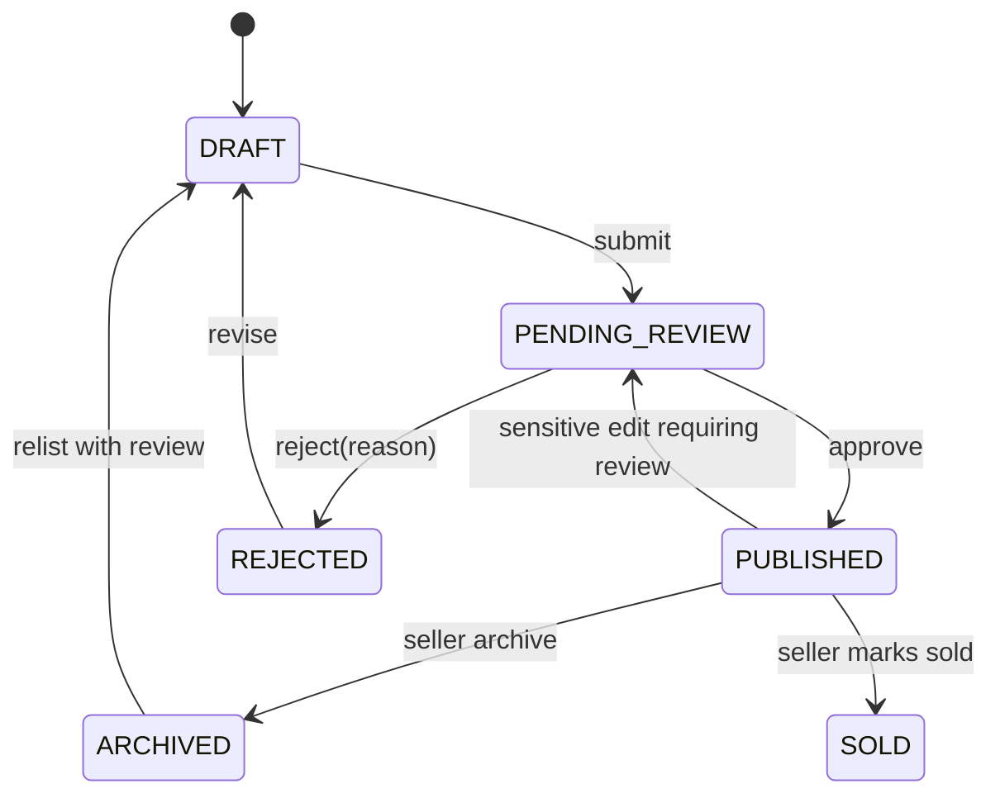
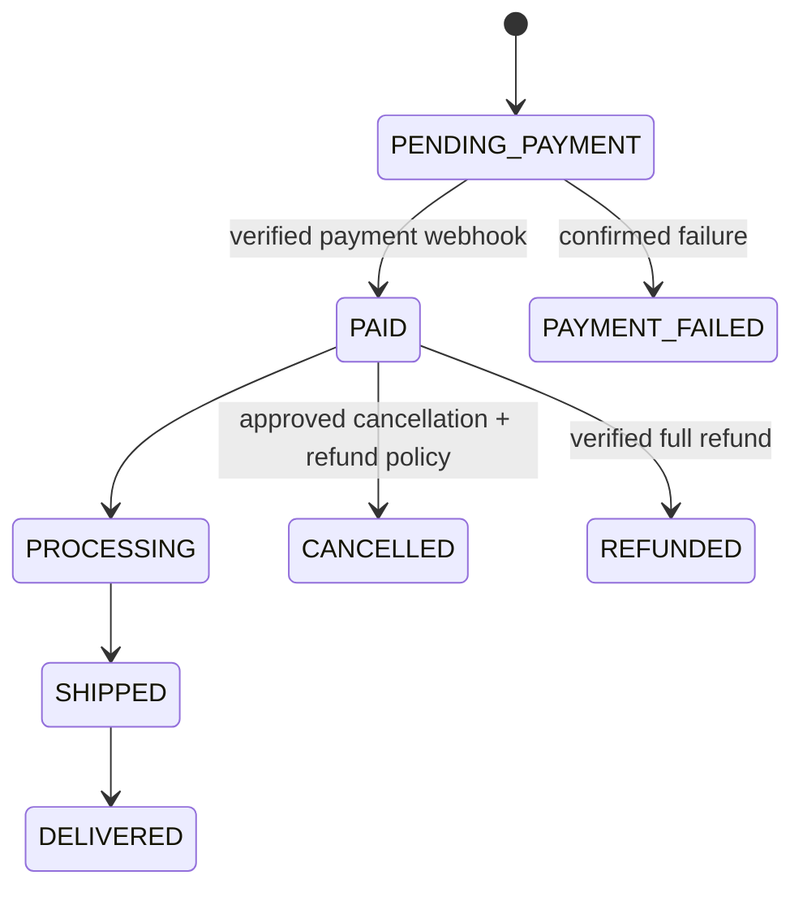

# Domain Contracts, State Machines, and Data Invariants

## Listing lifecycle

A listing title/price edit may require moderation by policy; always retain version and actor audit. Duplicate submission uses idempotency/version constraints.

EV-027 implements the database lifecycle locally for individual-owned demo data, with no listing endpoints. Submitted content is frozen; published numeric/content edits move back to PENDING_REVIEW, while photo changes require ARCHIVED→DRAFT relisting. Reviews require a different active moderator/admin and the current version. History/review records are immutable and snapshot only whitelisted non-text facts. Dealer membership, public visibility, badge evidence and live provider acceptance remain later gates.

## Enquiry lifecycle
`NEW → NOTIFIED → ACKNOWLEDGED → CLOSED` with `SPAM`/`BLOCKED` outcomes. Buyer may request follow-up privacy action. Seller never gets unrelated buyer PII merely by owning a listing.

## Payment/order lifecycle

Partial refund represented in refunds table and computed order net status rather than forcing every case into one enum. Check all state transitions and inventory reservation release.

## Finance lead lifecycle
`RECEIVED → CONSENT_VALIDATED → QUEUED → SENT → ACKNOWLEDGED`. Alternative `REJECTED` (invalid consent/provider), `WITHDRAWN` (consent revoked before dispatch). Do not infer loan approval from partner ACK.

## Badge integrity
- `Listed by Owner` means asserted listing role, not identity verified.
- `Identity Verified` requires verified evidence of subject identity and defined expiry.
- `Verified Dealer` requires approved dealer org verification; it does not certify every vehicle.
- `Battery Inspected` requires report issuer, date, method and acceptable evidence; never auto-generate.

## Catalogue truth
`claimed_range_km` must carry test cycle/source; `measured_range_km` separate field when sourced; charging connector compatibility for each exact variant only if verified. Price is city/type/date scoped, not one universal number.

## Concurrency invariants
- Inventory available-to-sell = on_hand - reserved ≥ 0.
- Payment events idempotent by provider event id.
- Lead delivery idempotent by lead/partner/delivery purpose.
- Verified claims derive from active verification rows, not user-provided booleans.
- Media attach requires owner + virus scan/allowed type/size.
- User data revocation must suppress pending future communications.

## Error cases
Use stable machine error codes: `AUTH_REQUIRED`, `FORBIDDEN`, `NOT_FOUND`, `STATE_CONFLICT`, `PRICE_CHANGED`, `STOCK_INSUFFICIENT`, `PROVIDER_UNAVAILABLE`, `CONSENT_REQUIRED`, `VERIFICATION_REQUIRED`, `RATE_LIMITED`, `PAYMENT_CONFIRMING`, `INVALID_UNITS`. No internal stack traces in client responses.
