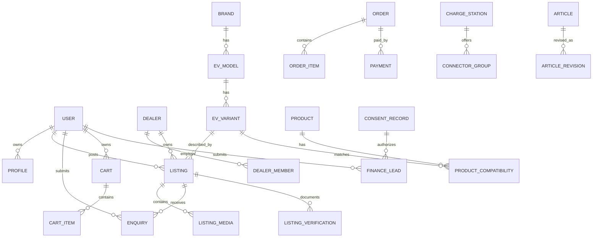

# EVONE — PostgreSQL Data Architecture and Schema Contract

## Conventions
- All entities: `id UUID PRIMARY KEY`, `created_at TIMESTAMPTZ`, `updated_at TIMESTAMPTZ`; soft delete only where explicitly needed (`deleted_at`).
- Money: `BIGINT` in **INR paise** (`price_paise`, `amount_paise`), never JS float money. All external pricing snapshot into order rows.
- Distance: `INTEGER odometer_km`; battery: decimal kWh; energy consumption: decimal kWh per km with explicitly recorded source; range: integer km + `range_standard` enum.
- Coordinates: PostGIS point in SRID 4326, with GiST index **only for permitted cached provider data**. Prisma version and PostGIS extension must be tested and pinned.
- Common status enums are server validated. Use distinct source/provenance fields for uncertain specs. Use partial unique indexes where appropriate and schema migrations not destructive in production.
- Personally identifying details are never included in public listing DTOs unless explicitly released; public ids are non-enumerable UUIDs/slugs.

## Core tables (ERD overview)

## Tables by bounded context
| Table | Essential fields | Index/constraint and notes |
|---|---|---|
| `users` | `auth_provider_id UNIQUE`, `email`, `phone_e164`, `status` | no password hash if managed auth |
| `profiles` | `user_id UNIQUE`, `display_name`, `city`, `notification_prefs` | user-private |
| `role_assignments` | `user_id`, `role`, `scope_type`, `scope_id`, `granted_by` | tenant-scoped roles |
| `consent_records` | `user_id nullable`, `purpose`, `partner_id nullable`, `privacy_version`, `consent_text_hash`, `ip_hash`, `granted_at`, `withdrawn_at` | immutable grant event + withdrawal event |
| `dealer_orgs` | `legal_name`, `display_name`, `city`, `approval_status` | no automatic badge |
| `dealer_members` | `dealer_id`, `user_id`, `role`, `status` | unique dealer/user |
| `verification_records` | `subject_type`, `subject_id`, `verification_type`, `verifier_id`, `evidence_key`, `expires_at`, `status` | private docs and approval history |
| `brands` | `name`, `slug`, `logo_key`, `status` | unique slug |
| `ev_models` | `brand_id`, `name`, `slug`, `vehicle_type`, `availability_status`, `release_date nullable` | composite brand/slug |
| `ev_variants` | `model_id`, `name`, `slug`, `battery_kwh`, `claimed_range_km`, `range_standard`, `motor_kw`, `charging_ac_kw`, `charging_dc_kw`, `warranty_text`, `data_status` | unique model/slug |
| `spec_sources` | `variant_id`, `field_name`, `value_text`, `source_url`, `effective_at`, `reviewed_at`, `reviewer_id` | cite per disputed claim |
| `vehicle_prices` | `variant_id`, `region_code`, `type`, `amount_paise`, `source_url`, `checked_at`, `valid_to` | price as-of locality/date |
| `listings` | `seller_user_id`, `dealer_id nullable`, `variant_id`, `slug`, `year`, `odometer_km`, `city`, `asking_price_paise`, `ownership_count`, `condition_notes`, `status`, `published_at` | indexes: status, location, variant, price |
| `listing_media` | `listing_id`, `object_key`, `position`, `alt`, `scan_status` | unique listing/position |
| `listing_history` | `listing_id`, `actor_id`, `before_json`, `after_json`, `action`, `reason` | audit; redact PII |
| `listing_verifications` | `listing_id`, `type`, `record_id`, `status`, `inspected_at`, `expires_at` | badge only approved/valid |
| `battery_inspections` | `listing_id`, `provider_id`, `soh_percent nullable`, `method`, `tested_at`, `report_object_key`, `confidence` | inspection vendor only; never approximate SOH |
| `enquiries` | `listing_id`, `buyer_user_id`, `seller_user_id`, `message`, `status`, `contact_share_consent_id`, `sent_at` | prevent duplicate spam |
| `favourites` | `user_id`, `listing_id`, `created_at` | unique pair |
| `products` | `sku UNIQUE`, `name`, `slug`, `category_id`, `description`, `price_paise`, `tax_class`, `active` | first-party merchant |
| `product_categories` | `name`, `slug`, `parent_id nullable` | indexed hierarchy |
| `product_media` | `product_id`, `object_key`, `position` | image optimization |
| `product_compatibility` | `product_id`, `variant_id`, `compatibility_status`, `notes`, `validated_at` | explicit verified mapping |
| `inventory` | `product_id UNIQUE`, `on_hand`, `reserved`, `version` | `on_hand >= reserved >=0` |
| `carts` | `user_id nullable`, `session_id nullable`, `status` | expires unused carts |
| `cart_items` | `cart_id`, `product_id`, `quantity` | server recomputes pricing |
| `orders` | `order_no UNIQUE`, `user_id`, `subtotal_paise`, `shipping_paise`, `tax_paise`, `total_paise`, `currency`, `status`, `address_snapshot_json` | immutable money snapshot |
| `order_items` | `order_id`, `sku`, `name_snapshot`, `quantity`, `unit_price_paise`, `tax_paise` | no pricing from client |
| `payments` | `order_id`, `provider`, `provider_order_id`, `provider_payment_id`, `amount_paise`, `status` | unique provider ids |
| `payment_webhook_events` | `event_id UNIQUE`, `payload_hash`, `processed_at`, `outcome` | idempotent handler |
| `shipments` | `order_id`, `carrier`, `tracking_number`, `status`, `shipped_at` | carrier optional |
| `refunds` | `order_id`, `payment_id`, `provider_refund_id`, `amount_paise`, `status` | approval process |
| `charge_stations` | `provider`, `provider_station_id`, `name`, `geom`, `address`, `metadata_source`, `metadata_checked_at` | retention only per license; source composite unique |
| `connector_groups` | `station_id`, `connector_type`, `charge_type`, `max_kw`, `count`, `available_count nullable`, `status_observed_at nullable` | explicit unknown if absent/stale |
| `charger_reports` | `station_ref`, `user_id nullable`, `issue_type`, `details`, `review_status` | do not auto-update source facts |
| `articles` | `slug UNIQUE`, `title`, `summary`, `body`, `category`, `author_id`, `status`, `published_at`, `canonical_url`, `feature_image_key` | publish workflow |
| `article_revisions` | `article_id`, `editor_id`, `body_snapshot`, `reason` | changelog |
| `partners` | `name`, `partner_type`, `status`, `legal_approval_at`, `api_config_ref` | active only if approved |
| `finance_leads` | `user_id nullable`, `kind LOAN/INSURANCE`, `status`, `vehicle_ref nullable`, `contact_name`, `email/phone`, `consent_record_id`, `partner_id nullable`, `sent_at` | sensitive restricted access, expiry |
| `lead_delivery_attempts` | `lead_id`, `partner_id`, `attempt_no`, `status`, `error_code`, `sent_at` | no plaintext PII in log |
| `notification_outbox` | `event_key UNIQUE`, `topic`, `payload_json`, `state`, `attempts` | event idempotency |
| `notifications` | `user_id`, `channel`, `template`, `status`, `delivered_at` | retries and preferences |
| `audit_events` | `actor_id`, `action`, `resource_type`, `resource_id`, `ip_hash`, `event_time`, `metadata_redacted` | append-only, restricted |
| `feature_flags` | `key UNIQUE`, `enabled`, `audience_json`, `updated_by` | kill switches |
| `support_tickets` | `requester_id`, `category`, `status`, `assigned_to`, `resolution` | support queues |

## Relationship rules
- `listings.variant_id` required after catalogue mapping; allow `OTHER` manual variant only with moderation and normalized brand/model fields during draft; no direct arbitrary brand string published without review.
- `dealer_id` optional; if present the creator must have active dealer membership and `MANAGE_INVENTORY` permission.
- `battery_inspections` only independently-issued records; no generic “good battery” badge based on seller self-report.
- `product_compatibility.compatibility_status` is `CONFIRMED|UNCONFIRMED|INCOMPATIBLE`; never infer confirmed from simple model name match.
- `finance_leads` cannot be delivered unless `consent_records` valid for kind/purpose/partner.
- `connector_groups.available_count` nullable; `0` means positively measured no free connectors, `NULL` means unknown.

## Suggested enums
`ListingStatus = DRAFT | PENDING_REVIEW | PUBLISHED | REJECTED | ARCHIVED | SOLD`
`DealerStatus = PENDING | APPROVED | REJECTED | SUSPENDED`
`OrderStatus = PENDING_PAYMENT | PAID | PROCESSING | SHIPPED | DELIVERED | CANCELLED | REFUNDED | PAYMENT_FAILED`
`LeadStatus = RECEIVED | CONSENT_VALIDATED | QUEUED | SENT | ACKNOWLEDGED | REJECTED | WITHDRAWN`
`ArticleStatus = DRAFT | REVIEW | PUBLISHED | ARCHIVED`
`AvailabilityState = AVAILABLE | UNAVAILABLE | UNKNOWN` (computed, not truthy boolean)

## Performance indexes and queries
- `listings(status,published_at DESC)`, `(status,asking_price_paise)`, `(variant_id,status)`, `(city,status)` plus GIN for full text/trigram.
- `enquiries(seller_user_id,status,created_at DESC)`.
- `orders(user_id,created_at DESC)`.
- `finance_leads(kind,status,created_at DESC)`.
- Charger GiST spatial index only if provider terms allow persistence; otherwise provider-native nearby API.
- Enforce DB constraints: price>0, year plausible, km>=0, nonnegative stock, `available_count <= count`, `soh_percent BETWEEN 0 AND 100` if present.

## Data governance and migrations
- Source URL + checked date on specs/prices; do not scrape copyrighted descriptions wholesale.
- Restrict private IDs and signed document access; short-lived object access and review-only permissions.
- Data retention policy approved by counsel; deletion/request workflows and backups policy.
- Migration flow: schema review → migration SQL → staging test → backup → prod deploy → post-migration verification; prefer expand/contract.
- Generate seed demo content with `demo=true` and conspicuous labels; never push staged fake verification into production.

## Prisma/PostGIS note
Tested 2026-11-03 (ADR-012, `04_Delivery/11_ADR-012_prisma_postgis_spike.md`): Prisma 7.10.1 still has **no native PostGIS types**. Declare spatial columns as nullable `Unsupported("geography(Point, 4326)")?` with `@@index([geom], type: Gist)` and the `postgresqlExtensions` preview feature; read and write them with parameterised raw SQL. Migrations, drift checks and GiST index use were verified on PostgreSQL 17.5 / PostGIS 3.5.2. Deployment-host PostGIS support is still unverified. Reference: https://www.prisma.io/docs/orm/extensions/postgis
