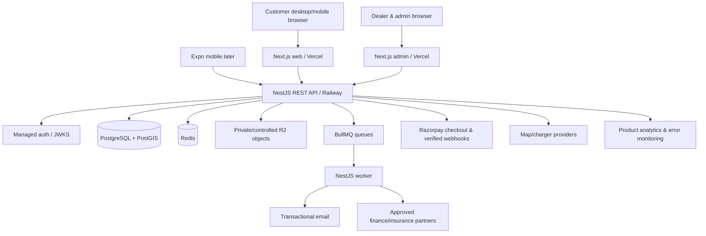

# EVONE — End-to-End System Design

## Architecture decision
**Modular monolith**, API-first, web-first. One deployable NestJS backend plus a BullMQ worker, not microservices. One authoritative PostgreSQL database with PostGIS. Shared contracts drive frontend and mobile consumers. Background tasks and external integrations isolated behind adapters.

## Module boundaries (NestJS)
- `identity`: profiles, session verification, consent and user permissions.
- `catalogue`: brands, models, variants, verified specs/provenance.
- `marketplace`: listings, media, moderation, enquiries, favourites.
- `dealers`: dealer organisations, members, approval and lead inbox.
- `commerce`: products, stock, carts, checkout, orders and refunds.
- `calculator`: pure tested savings/EMI formulae and optional anonymous use.
- `charging`: provider-adapter search, geospatial locations, connector aggregation and provenance.
- `editorial`: article CMS, publishing states, categories and SEO.
- `finance`: explicit leads, partner routing, consent and lead lifecycle.
- `notifications`: email/job templates, idempotency and delivery status.
- `admin`: moderation, staff activity, audit logs, feature switches.

## Data ownership and transaction boundaries
Each module owns writes to its tables. Other modules read through services/projections, not arbitrary cross-module mutations. PostgreSQL ACID transactions for listing publish, stock reservation, order payment status; **outbox pattern** for important side effects after commit. Store all money as integer INR paise, timezone-aware UTC instants, ISO currency `INR`.

## Read paths
- Public catalogue/listings: Next.js SSR/ISR (revalidation on publish), read-optimized indexed DB queries, CDN caching for non-personalized data.
- Filters: URL-driven paginated query; simple Postgres `tsvector`+trigram search initially; avoid Meilisearch before needed.
- Stations: provider adapter returns normalized charging objects; PostGIS nearest lookups only for licensed data EVONE may cache. Never import a whole Google Places dataset into persistent DB without permission.
- Profile/orders/leads: authenticated API, no caching in public CDN.

## Write paths
1. Client validates locally using shared Zod schema.
2. API authenticates and authorizes, validates again, applies throttles.
3. Service checks state/ownership, writes database transaction.
4. After commit, outbox/queue emits notifications/index updates.
5. Audit entry stores actor, action, resource id, timestamp and safe diff.

## SEO and media
- Canonical URLs `/used-evs/[slug]`, `/evs/[brand]/[model]/[variant]`, `/news/[slug]`; metadata/structured data only when real.
- R2 pre-signed upload with MIME/size limits and scanning/re-encoding pipeline, no anonymous private docs.
- Vehicle photos optimized with responsive sizes; consent/license for every image.

## Reliability and operational targets (proposed, not guarantees)
- API availability pilot target 99.5%; define incident response before public claims.
- API p95 target < 400ms for basic reads under expected pilot traffic (excluding map provider network latency); baseline via load tests.
- Daily backups with restore drills; target RPO ≤24h and RTO ≤8h at pilot stage, verify with provider plan.
- Graceful degraded states when maps, lender partner or emails unavailable; critical order/payment status reconciled on recovery.

## Payments and purchase boundary
Only accessory orders and paid listing promotions accept payments. Payment created server-side with exact amount. Webhook signature verified; event recorded once. Order marked PAID only on trusted verified event/reconciliation. Used EV buyer–seller transaction happens separately and EVONE makes no escrow claim.

## Charging freshness boundary
Metadata can come from Places or licensed charge-provider feed. Static power/connector fields are distinct from dynamic availability. Every availability value has `source`, `observedAt`, `validUntil` (if contract supplies), and confidence/staleness rules. Missing or stale → UNKNOWN.

## Privacy and finance boundary
Finance data is minimal, consent records are auditable, partner export guarded by legal/contract approval. No credit scores, PAN/Aadhaar, bank statements or sensitive underwriting documents collected for MVP leads. Lenders/insurers own underwriting/issuance.

## Evolution triggers
Separate a service **only** when scaling/security/regulatory and team boundaries justify it. Meilisearch when Postgres search misses measured SLA; live charging operator integration when station use and partner agreements justify; native Expo app after mobile funnel needs warrant build cost.

## Code quality rules
Strong types, server-enforced auth, idempotent mutations, deterministic decimal money utilities, test seams around external APIs, input validation, logging with PII redaction, migrations reviewed, contracts regenerated in CI.

## Detailed reading
[`DATABASE.md`](DATABASE.md), [`API_CONTRACT.md`](API_CONTRACT.md), [`03_Engineering/01_repository_infra.md`](03_Engineering/01_repository_infra.md), [`03_Engineering/03_security_auth_privacy.md`](03_Engineering/03_security_auth_privacy.md), [`03_Engineering/04_external_integrations.md`](03_Engineering/04_external_integrations.md)
